# EasyAI v1.1.0 — User Manual

EasyAI is a Windows desktop app for making AI pictures, videos and better
prompts without touching a node editor. Pick a style, type what you want,
choose a shape, press Create — EasyAI drives ComfyUI (the engine that does
the actual generation) behind the scenes. It's aimed at people who want the
results ComfyUI can produce without learning ComfyUI itself.

EasyAI actually comes as **three separate programs** that share the same
look and settings language:

- **EasyAI** — the day-to-day app: Image, Video, Prompt Helper, Queue and
  Read a prompt tabs. This is what most people run.
- **EasyAI Setup** — a one-time (or occasional) installer/updater that
  downloads ComfyUI and the specific models and add-ons EasyAI's workflows
  need, or updates a ComfyUI you already have. Run this before EasyAI if you
  don't already have ComfyUI installed.
- **EasyAI Studio** — a publishing tool for people who maintain or add
  workflows to EasyAI. Most users will never need to open this.

This manual covers all three.

## Installation & Requirements

- **Operating system**: Windows only.
- **Graphics card**: an NVIDIA graphics card is required. EasyAI's workflows
  were built and tested on a 16 GB card.
  <!-- TODO: confirm exact minimum VRAM figure for smaller cards -->
- **ComfyUI**: EasyAI does not include ComfyUI itself. Either point EasyAI's
  Settings at a ComfyUI install you already have, or run **EasyAI Setup**
  first to download one for you (a tested version, currently ComfyUI
  0.37.0).
- **Disk space for downloads** (via EasyAI Setup): roughly 76 GB for the
  Image group of models, 138 GB for Video, and 5 GB for Prompt Helper. You
  don't need all three — choose only the groups you want.

### Running the prebuilt version (recommended for most people)

If you downloaded `EasyAI.exe` and `EasyAI Setup.exe` from the Releases
page, nothing else needs installing — no Python required. Keep the `.exe`
files in a folder you can write to (not inside `Program Files`), because
EasyAI keeps its settings, workflows and results in folders right next to
the program.

1. Run **EasyAI Setup.exe** first if you don't already have ComfyUI.
2. Once that finishes, run **EasyAI.exe**.

### Running from source (technical users)

```bash
pip install -r requirements.txt
python EasyAI.py
```

Double-clicking `EasyAI.bat` does the same thing automatically: it finds
Python, installs the required libraries the first time only, then always
starts the app without a console window. `EasyAISetup.bat` and
`EasyAI Studio.bat` start the other two programs the same way. Python 3.10
or newer is required when running from source; `EasyAI.bat` checks this and
links to the Python download page if your version is missing or too old.

## First-Run Setup

The very first time you start EasyAI, before you can create anything, you
will see a short welcome message.

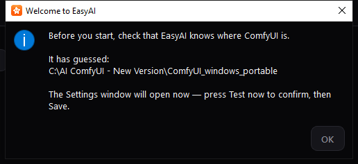

It tells you that EasyAI has guessed where your ComfyUI folder is, and that
it's about to open **Settings** so you can check that guess. Press **OK** to
continue — Settings opens automatically right after.

This message only appears once. After you close it, EasyAI remembers that
first run is done, whether or not you changed anything in Settings.

## Feature Walkthrough

### Settings

Settings is where you tell EasyAI where ComfyUI lives, where your workflows
and results are stored, and set a few generation defaults and the app
language. You can open it any time from **File → Settings…** (or `Ctrl+,`),
not just on first run.

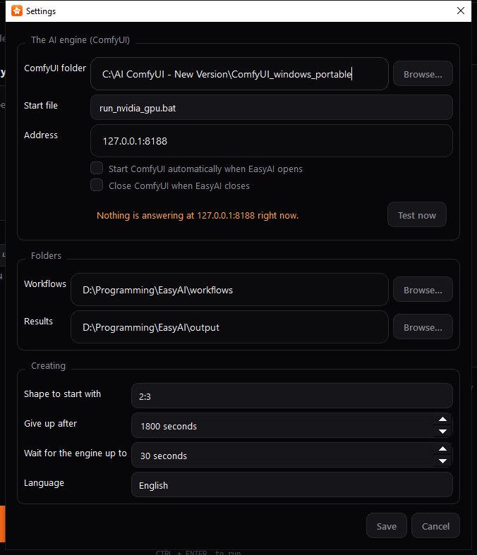

**The AI engine (ComfyUI) section:**

1. **ComfyUI folder** — type or **Browse…** to the folder ComfyUI is
   installed in.
2. **Start file** — a dropdown of every launcher file EasyAI found in that
   folder; pick the one that starts ComfyUI on your machine.
3. **Address** — the `host:port` ComfyUI answers on. The default,
   `127.0.0.1:8188`, is correct for almost everyone.
4. Two checkboxes: **Start ComfyUI automatically when EasyAI opens**, and
   **Close ComfyUI when EasyAI closes** (this only ever closes a ComfyUI
   that EasyAI itself started — one you started by hand is left alone).
5. A status line and a **Test now** button let you check right away whether
   EasyAI can talk to ComfyUI at the settings you've entered. In the
   screenshot above no ComfyUI was running, so it reads "Nothing is
   answering at 127.0.0.1:8188" — once ComfyUI is reachable this line turns
   green and reads "ComfyUI is answering at …".

**Folders section:** where **Workflows** and **Results** are stored. Both
default to folders sitting right next to EasyAI itself, so you can move or
copy the whole EasyAI folder and it keeps using its own workflows/results.

**Creating section:** a default **Shape to start with**, how long to wait
before giving up on a stuck generation ("Give up after") or a slow ComfyUI
launch ("Wait for the engine up to"), and a **Language** dropdown (English,
繁體中文, 简体中文). Changing the language takes effect the moment you press
**Save** — no restart needed.

Press **Save** to keep your changes, or **Cancel** to discard them. If you
change the ComfyUI folder, start file, address, or workflow folder, EasyAI
re-checks the engine and reloads your workflow list automatically.

### Startup Splash

If ComfyUI isn't already running when EasyAI starts, you'll briefly see a
progress screen while EasyAI looks for it (and, if "Start ComfyUI
automatically" is on, starts it for you).

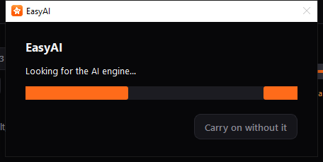

It shows an indeterminate progress bar and a status line. If you don't want
to wait, press **Carry on without it** — the main window opens right away,
though you won't be able to create anything until the engine connects. If
ComfyUI genuinely fails to start, EasyAI tells you it's still fine for
browsing but not for creating.

If ComfyUI is already running and answering when you start EasyAI, this
screen is skipped entirely.

### Main Window

This is the app's home screen: an engine status strip, five tabs, a menu
bar, and a status bar.

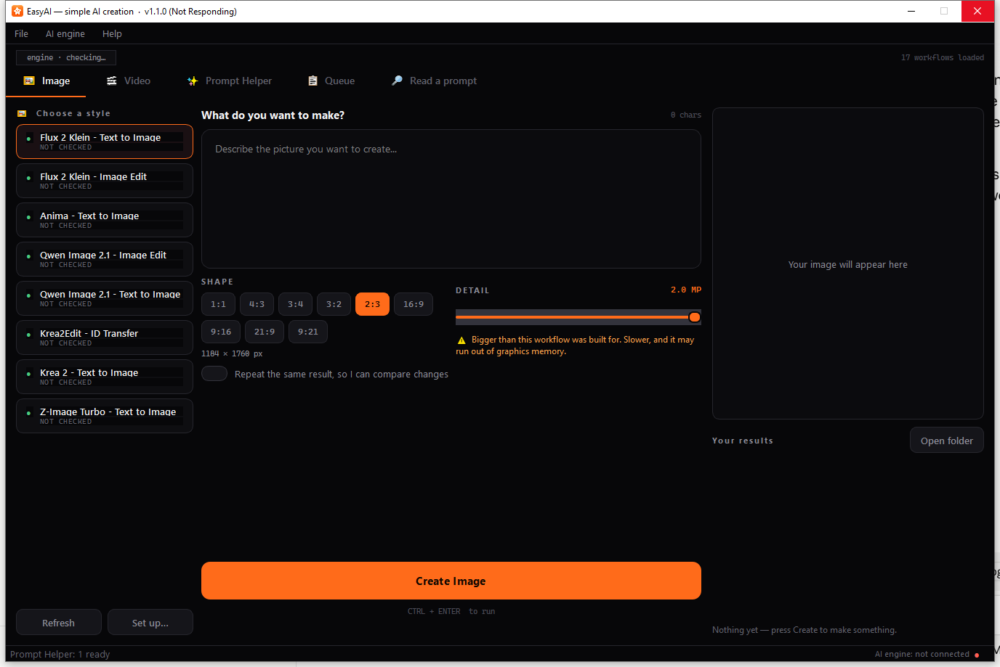

- The strip above the tabs shows whether the engine is live (`engine live ·
  127.0.0.1:8188`) or down (`engine down · …`), plus how many workflows are
  loaded.
- The tab bar runs: Image, Video, Prompt Helper, Queue, and Read a prompt.
- The bottom status bar shows VRAM usage once the engine is running, plus a
  coloured dot and "AI engine: running/not running" text.
- The **File** menu holds Open the workflows folder, Open the results
  folder, Settings…, and Quit.
- The **AI engine** menu holds Check it is running (`F5`), Start it now, and
  Reload workflows (`Ctrl+R`).
- The **Help** menu holds "How do I add a workflow?" and "About EasyAI".

Handy shortcuts: `Ctrl+Enter` runs Create on whichever tab is in front,
`Ctrl+,` opens Settings, `F5` checks the engine, `Ctrl+R` reloads workflows.

EasyAI remembers the window's size and position between sessions. When you
close the window, if anything is still in the Queue, EasyAI asks first (see
the Queue section below) before shutting anything down.

### Image tab

Pick a workflow ("style") on the left, describe what you want in the
middle, and watch the result appear on the right.

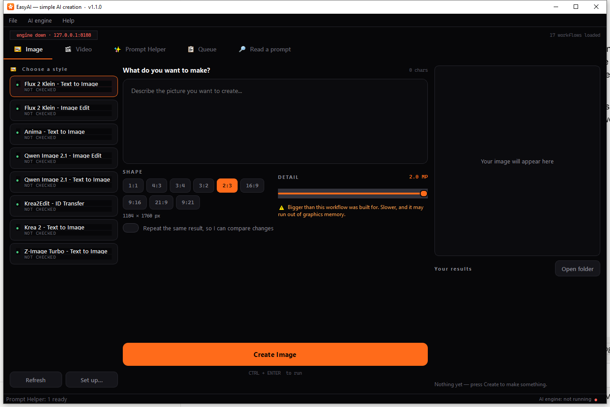

1. **Choose a style** (left column) — scroll the list of workflow cards.
   Each shows a coloured status dot: green means ready, amber means it needs
   checking, red means something (an add-on or model) is missing. Use
   **Refresh** after adding new workflow files, and **Set up…** to correct
   how EasyAI has guessed a workflow works (see the Manifest Editor section
   below). Right-click a workflow for **Rename…**, **Set up…**, or **Show
   the file**; double-clicking a workflow also renames it.
2. **Describe it** (middle column) — type your prompt in the box at the top;
   a live character counter tracks its length. Some workflows disable the
   prompt box entirely if they don't take one.
3. **Negative prompt** — for workflows that support it, a second box labelled
   **NEGATIVE PROMPT** appears, often pre-filled with useful default text.
   Leave it as-is to use that default, edit it to change it, or clear it to
   send no negative prompt at all.
4. **Attach files** — workflows that need a picture, audio or video to work
   from show labelled drop zones; click or drag a file in. Only a few slots
   show at once, with the rest reachable by scrolling, so even a workflow
   with many file slots stays usable.
5. **Reference pictures that grow one at a time** — some workflows (built on
   Qwen Image 2.1) can take up to 10 reference pictures. EasyAI only shows
   you **Reference 1** at first; as soon as you fill it, **Reference 2**
   appears, and so on, up to 10. If you remove a picture partway through the
   list, the remaining ones shift up so there's never a gap.

  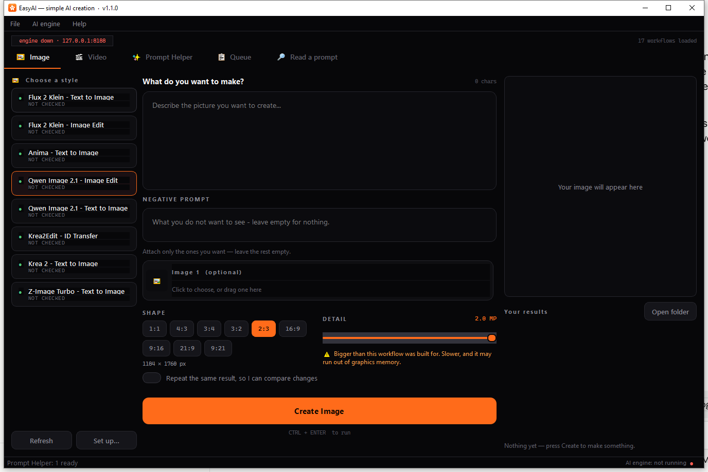

  <!-- TODO: confirm appearance of Reference 2 and later slots — only the
  first slot ("Image 1"/"Reference 1") could be captured for this manual;
  filling it to reveal the next slot was not captured. -->
6. **Model picker** — when a workflow's model folder contains more than one
   file of the same type (for example several checkpoints of the same
   family), a **MODEL** dropdown appears so you can pick which one to use;
   the workflow's own default is marked "(in the workflow)". This only shows
   up when there's a genuine choice to make.
   <!-- TODO: confirm — a screenshot of the Model picker itself could not be
   captured, since it needs a real ComfyUI models folder with more than one
   matching model file. Described here from the outline only. -->
7. **Shape, Detail, batch** — a row of shape chips (e.g. square, portrait,
   landscape — whatever the workflow supports), a Detail slider controlling
   output resolution/quality (with a warning above a certain level, since
   higher detail uses more graphics memory), and a "How many" count for
   workflows that support batches.
8. Two optional switches: **"Let the AI improve my wording first"** (turns on
   an automatic prompt-enhancer for workflows that have one) and **"Repeat
   the same result, so I can compare changes"** (locks the random seed so
   you can compare small changes fairly).
9. At the bottom, always visible even while you scroll the rest of the
   column: the **Create Image** button, a **Stop** button (once something is
   running), a "CTRL + ENTER to run" hint, a progress bar, and a status line
   that, after a run finishes, shows elapsed time, file size, count, seed,
   and any notes.
10. **Right column** — a live preview of the image as it generates, and a
    Results gallery of everything you've made this session, with an **Open
    folder** button and double-click-to-view.

If you press Create while the engine isn't running, EasyAI warns you and
points you to Settings. If a required file is missing, EasyAI tells you
exactly what's needed before sending anything.

### Video tab

Works the same way as the Image tab, with two differences: a **Length**
control (in seconds, with the resulting frame count shown underneath, and a
caution above 8 seconds about graphics-memory use) replaces the still-image
size choice for length, and the results preview shows the finished video's
**first frame** — both in the live preview pane and in the gallery
thumbnails — so you can tell several takes apart at a glance. Double-click a
result to open the actual video in your normal video player.

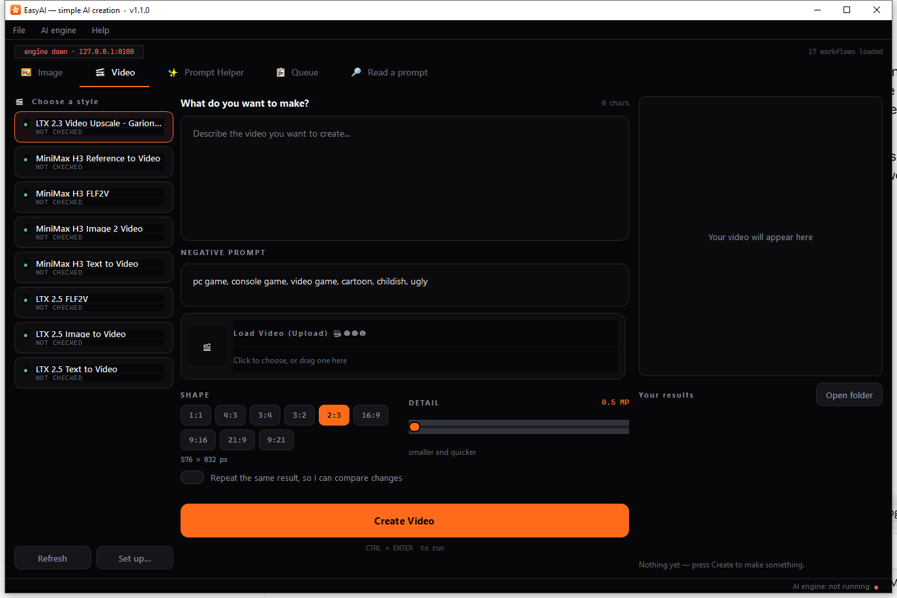

The Detail warning threshold is lower on Video than on Image, since a
higher setting costs graphics memory once per frame rather than once per
image.

### Prompt Helper tab

Use this tab when you want AI help turning a rough idea into a fuller
prompt, rather than to generate a picture or video directly.

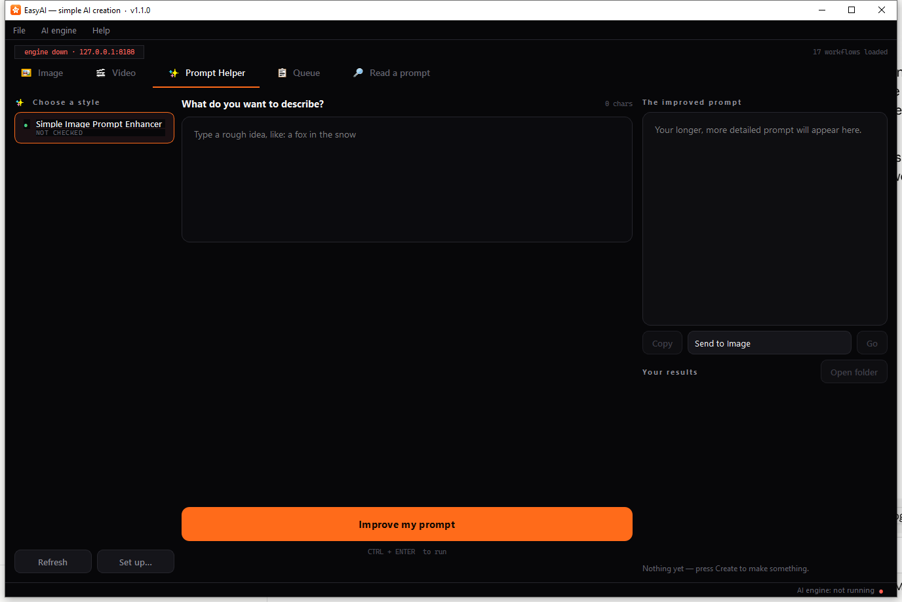

Type your rough idea and press **Improve my prompt**. Instead of a picture
preview, this tab shows:

- **THE IMPROVED PROMPT** — a read-only box with the result.
- **Copy** — copies the text.
- A **"Send to Image/Video"** dropdown plus **Go** — drops the improved
  prompt straight into the chosen tab's prompt box and switches you there.
- A history list of everything you've generated with Prompt Helper before,
  which you can click to reload.

Every result is also saved to a text file automatically, so nothing is
lost even after you close EasyAI.

### Queue tab

Every press of Create — on any of the three Generate tabs — adds a job here
rather than running immediately. Because there's one GPU, jobs run one at a
time in order.

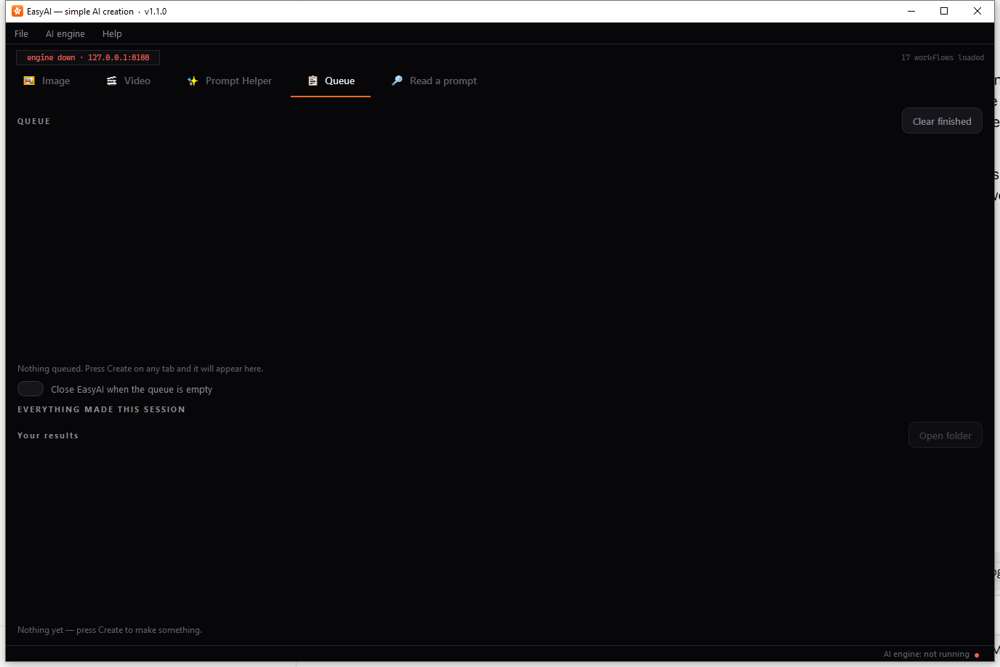

The screenshot above shows the empty state you'll see before anything has
been queued: "Nothing queued. Press Create on any tab and it will appear
here." Once jobs are queued, this screen instead shows:

- A running count ("1 running · N waiting").
- One row per job, showing its state (waiting, running, done, failed, or
  cancelled), which tab it came from, the workflow name, a short summary, a
  progress bar while it runs, and a cancel button.
- **Clear finished** to tidy up completed rows.
- **"Close EasyAI when the queue is empty"** — a switch that, combined with
  "Close ComfyUI when EasyAI closes" in Settings, lets you queue up a batch
  of jobs, walk away, and have both EasyAI and ComfyUI shut down on their
  own once everything's done. This switch resets to off every time you
  start EasyAI, so it never surprises you on a night you forgot it was set.
- A gallery of everything made in the current session, below the queue
  list.

<!-- TODO: confirm exact wording — a screenshot with running/waiting jobs,
the 20-second close countdown dialog, and the "Still working" exit-guard
dialog could not be captured for this manual, since capturing without
starting ComfyUI meant no job could actually be queued. -->

When the queue does empty out with "Close when empty" turned on, EasyAI
shows a message saying everything is finished and counts down 20 seconds,
with **Stay open** (the default) and **Close now** buttons. Choosing Stay
open turns the switch back off so you won't be asked again next time.

If you try to close EasyAI while jobs are still running or waiting, EasyAI
stops you with a warning naming how many are in progress, offering **Keep
working** (switches you to the Queue tab) or **Cancel everything and
close**.

### Read a prompt tab

Use this to recover the prompt that made an existing picture or video —
useful when you've forgotten what you typed, or you're curious how someone
else's image was made. It works even with ComfyUI closed.

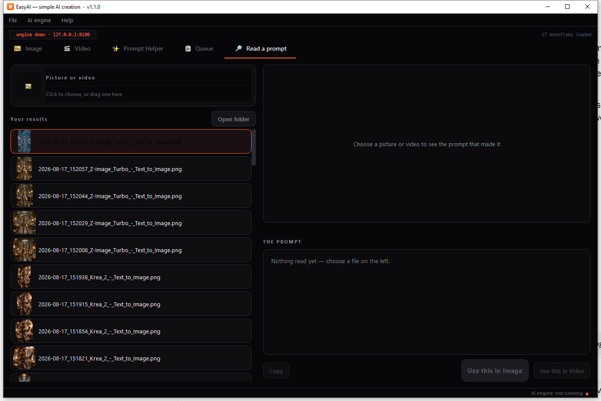

Drag a picture or video onto the drop zone on the left, or click it to
browse for one — or pick one from the results gallery underneath it, which
lists recent files from all three output folders (Image, Video, Prompt
Helper).

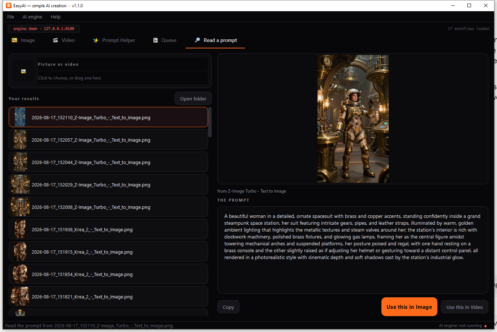

Once a file is chosen, the right side shows a preview and, if a prompt could
be found embedded in the file, "THE PROMPT" with the recovered text, plus
**Copy**, **Use this in Image**, and **Use this in Video** buttons. Above
the prompt box, a short line tells you where the text came from:

- **"from <workflow name>"** — EasyAI matched the file to one of your own
  workflows.
- **"best guess — this workflow is not one of yours"** (shown in an amber
  warning colour) — the file wasn't made with any workflow EasyAI
  recognises, so it's showing its best guess at the prompt anyway.

If the file has no prompt embedded at all — common for pictures that have
been re-saved, sent through a messaging app, or downloaded from most
websites — you'll see "This file does not carry a prompt…" and the Copy/Use
buttons stay disabled. If the file has since been deleted, EasyAI tells you
"That file is no longer there."

This tab refreshes its list every time you open it, so new results and
newly added workflows show up without restarting EasyAI.

### Set up… (Manifest Editor)

EasyAI guesses, automatically, which parts of a workflow's internal node
graph correspond to the prompt, negative prompt, shape, seed, length, and so
on. The Manifest Editor lets you correct those guesses by hand, without
editing any files directly.

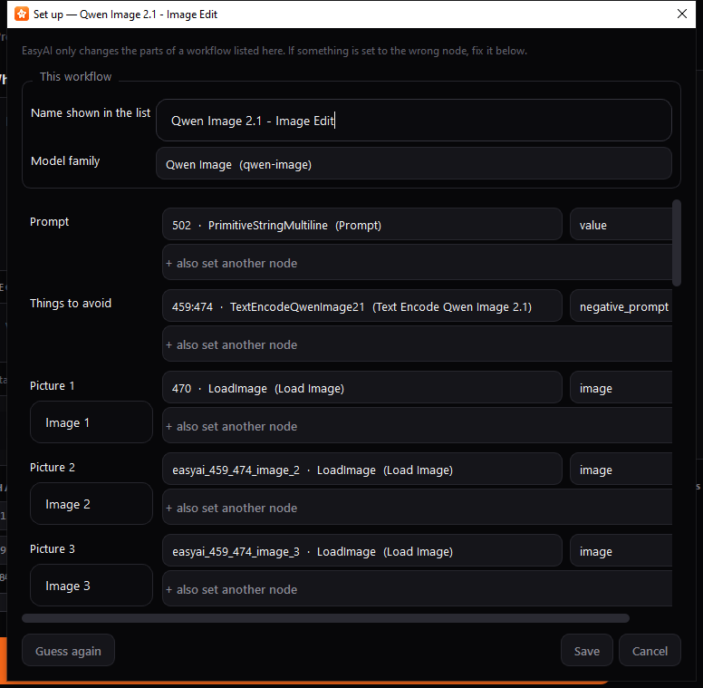

Open it via the **Set up…** button on a Generate tab, right-click a
workflow and choose **Set up…**, or when a workflow is flagged "CHECK SET
UP" in the workflow list.

- **Name shown in the list** — rename the workflow as it appears to you.
- **Model family** — leave as "Work it out automatically", or pick a
  specific engine if EasyAI guessed wrong; this decides which set of shapes
  is offered.
- One row per setting (Prompt, Negative prompt, Width, Height, Seed, and so
  on, plus a row for each file slot) — each lets you pick which node and
  input in the graph that setting should control.
- **Save** keeps your changes and marks the workflow as manually configured
  (so it won't be silently re-guessed later). **Guess again** re-runs the
  automatic detection (discarding your edits in this dialog, until you press
  Save). **Cancel** closes without saving.

Your corrections are stored in a small file next to the workflow and are
kept even if you later re-export the same workflow from ComfyUI.

### Rename dialog

A simple way to give a workflow a friendlier name than its file name.

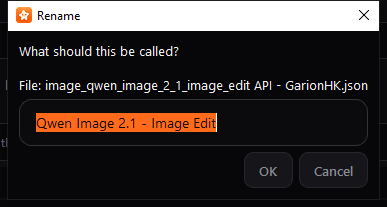

Open it with `F2` on a selected workflow, by double-clicking a workflow, or
via right-click → **Rename…**. Type the new name and press OK. Clearing the
name entirely reverts to using the file name.

### Help → How do I add a workflow?

A quick in-app reminder of the steps for adding a new workflow: export it
from ComfyUI using Export (API), save it into the right folder, then press
Refresh.

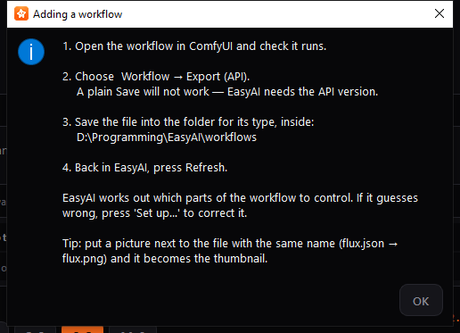

The message names your actual current workflow folder, taken from Settings.

### Help → About EasyAI

Shows the app version and a reminder of where your workflows and results
are currently stored.

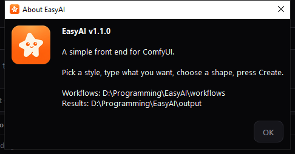

## EasyAI Setup

Run this program to install ComfyUI and the models/add-ons EasyAI's
workflows need, or to update a ComfyUI you already have. It's one long
scrollable screen, meant to be read top to bottom.

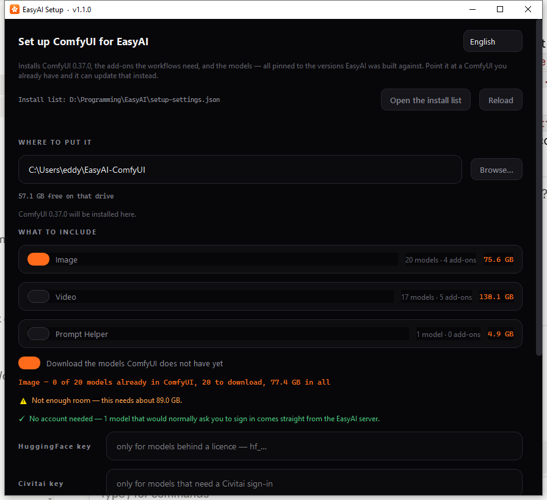

1. Pick a **Language** at the top right if needed.
2. Read the blurb naming which ComfyUI version will be installed.
3. The **install list** row shows where the list of things to install comes
   from — either built into Setup, or a `setup-settings.json` file next to
   it that you can open, edit and reload (see Settings Reference below for
   what's in it).
4. **WHERE TO PUT IT** — choose a destination folder (defaults to
   `~/EasyAI-ComfyUI`); a free-disk-space readout appears alongside it.
5. Once a folder is chosen, a line appears telling you what Setup found
   there:
   - An empty folder: "ComfyUI {version} will be installed here."
   - A folder that already matches: "✓ ComfyUI {version} is already here,
     with EasyAI's add-ons at their tested versions" — nothing to do.
   - An existing but older/newer/mismatched ComfyUI: a message naming both
     versions, together with a switch to update it to the tested version (or
     to change it back down, if the found copy is newer). This switch
     defaults on for an older install and off for a newer one, but only the
     first time — after that, your own choice is remembered.
   <!-- TODO: confirm exact wording — this "found ComfyUI here" state, with
   the update switch, could not be captured for this manual without
   pointing Setup at a real ComfyUI install; the screenshot above shows the
   empty-folder default state instead. -->
6. **WHAT TO INCLUDE** — one card per group of models/add-ons (Image, Video,
   Prompt Helper), each a simple on/off switch showing how many models and
   add-ons it includes and its total download size.
7. **"Download the models ComfyUI does not have yet"** — on by default;
   models ComfyUI already has are never re-downloaded. Turn this off to
   install or update just ComfyUI and its add-ons, without any models.
8. A running total line tells you how much will actually be downloaded,
   followed by a free-space readout and any warnings — for example, not
   enough disk space, or models with no automatic download link (which
   you'd need to copy in yourself), or models that need a HuggingFace or
   Civitai account.
9. If any gated models are needed, **HuggingFace key** and **Civitai key**
   fields let you paste in an access key for the current run only — nothing
   is saved to disk.
10. Press **Install**. A confirmation dialog first states the exact download
    size, destination, and plan. A **Stop** button appears while installing
    (it finishes the current file, then stops); a progress bar, current
    file/speed/ETA, and a scrolling log show progress.

Installing is resumable — if it's interrupted, running Setup again picks up
where it left off, including part-finished downloads. When it finishes, it
tells you EasyAI is already configured to use the new ComfyUI, or, if it
couldn't update EasyAI's settings itself, gives you the exact folder path to
paste into EasyAI's own Settings.

## EasyAI Studio

Studio is a maintainer/publishing tool, not something a day-to-day EasyAI
user needs. It has a navigation rail on the left and a page area on the
right, rather than a single top-to-bottom flow like Setup.

### Add a workflow

Package an already-working ComfyUI workflow so EasyAI Setup can install its
models for everyone else.

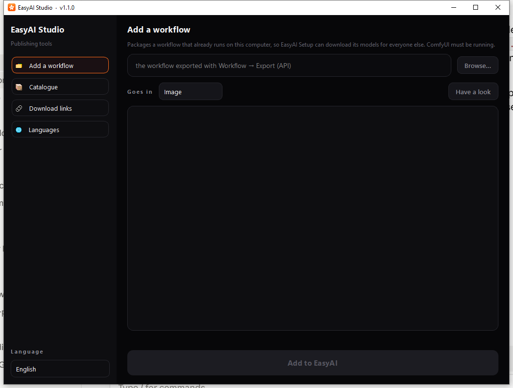

Browse to a workflow `.json` file, confirm which group it belongs in (Image,
Video, or Prompt Helper — guessed automatically from the filename but always
changeable), and press **Have a look**. This requires a running ComfyUI,
since only the live engine can say which folder each model belongs in. The
report shows the node count, what EasyAI can drive, every model found and
its download-link status, and any add-ons needed. Once the report says the
workflow can safely be added, press **Add to EasyAI**.

### Catalogue

Rebuilds the master install list that EasyAI Setup uses, based on what's
installed on this machine.

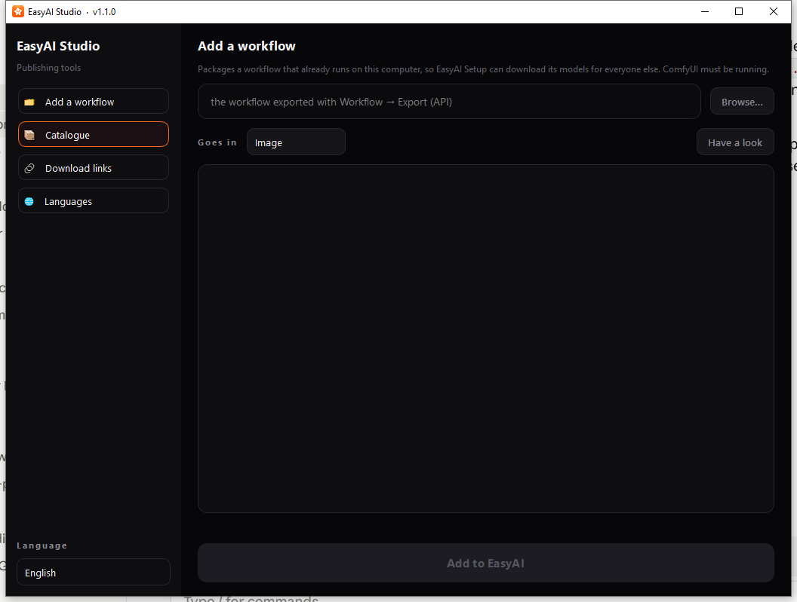

**Update folders and mirrors** does a lighter refresh; **Rebuild
everything** does a full rebuild (requires a running ComfyUI). A summary
line and scrolling log show progress and results.

### Download links

Checks that every model's download link still works and still serves the
right file.


**Check the original sources** verifies links against their original
providers; **Check my mirror** checks the maintainer's own mirror server
instead. A summary line shows how many links need checking, are mirrored,
or need an account.

### Languages

Finds text that's been added to the programs since the translation files
were last updated, for 繁體中文 and 简体中文.

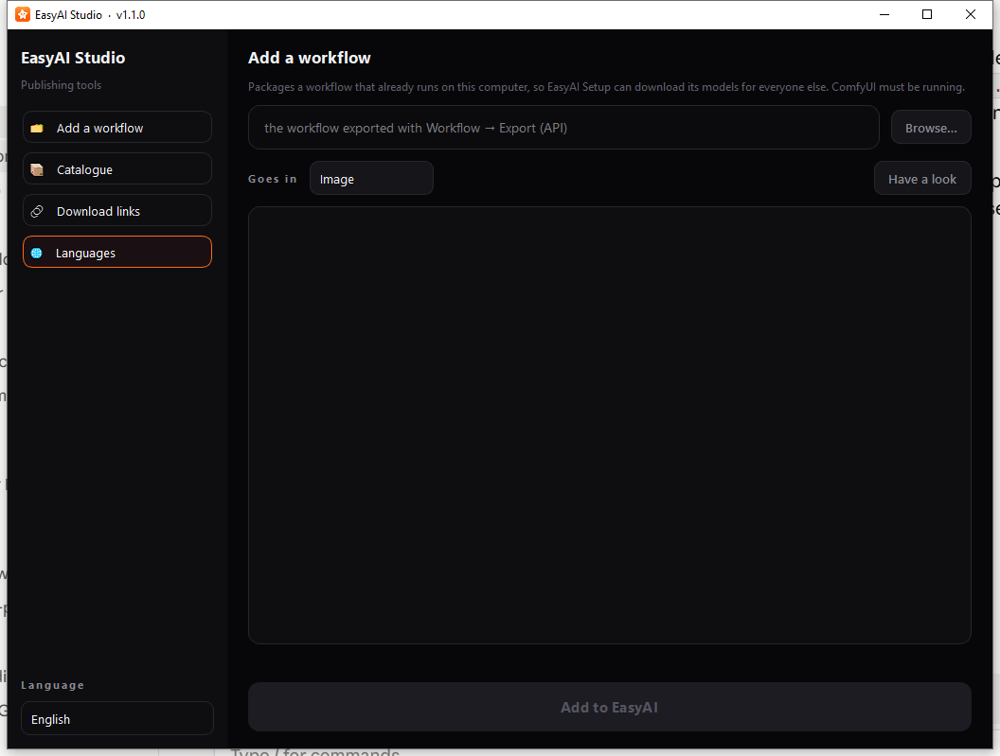

**What is missing?** reports what needs translating without changing
anything. **Add new text to the language files** adds the new entries with
empty values, ready for a translator to fill in.

## Settings Reference

All settings live in `settings.json`, kept beside EasyAI (or beside the
built `.exe`). You should not normally need to edit this file by hand — use
the Settings dialog instead — but this table explains every value in it.

| Setting | What it does | Default |
|---|---|---|
| ComfyUI folder | Folder where ComfyUI is installed. | `C:\AI ComfyUI - New Version\ComfyUI_windows_portable` |
| Start file | Which file inside that folder starts ComfyUI. | `run_nvidia_gpu.bat` |
| Address | Address EasyAI talks to ComfyUI on. | `127.0.0.1:8188` |
| Start ComfyUI automatically | Whether EasyAI starts ComfyUI itself if nothing answers. | On |
| Wait for the engine up to | How long to wait for ComfyUI to start before giving up. | 300 seconds |
| Give up after | How long a single generation may run before EasyAI gives up on it. | 1800 seconds |
| Close ComfyUI when EasyAI closes | If EasyAI started ComfyUI, close it again on exit. Never closes a ComfyUI started some other way. | On |
| Close EasyAI when the queue is empty | Queue tab switch; auto-closes EasyAI once nothing is left queued. Always resets to off at the start of every session. | Off |
| Workflows folder | Folder holding your workflow files. | `workflows` folder beside EasyAI |
| Results folder | Folder generated files are saved into. | `output` folder beside EasyAI |
| Shape to start with | Shape chip pre-selected when you pick a workflow. | `2:3` |
| Repeat the same result (seed lock) | Whether "repeat the same result" starts ticked. | Off |
| Model choice | Remembered alternate model per workflow (Model picker), without changing the workflow file itself. | (none) |
| How many (batch count) | Default value of the batch-count box. | 1 |
| Let the AI improve my wording first | Default state of the prompt-enhancer switch. | On |
| Image Detail | Remembered Detail value for the Image tab. | 1.0 MP |
| Video Detail | Remembered Detail value for the Video tab. | 0.5 MP |
| Image Detail warning level | Detail value above which the Image tab warns about memory use. | 1.5 MP |
| Video Detail warning level | Same, for Video (lower, since video pays the cost per frame). | 1.0 MP |
| Video length | Length box's starting value. | 5 seconds |
| Video length range | Minimum/maximum of the Length box. | 2–15 seconds |
| Video length warning level | Above this, the Length control shows a memory caution. | 8 seconds |
| Language | Which language the app displays in. | English |
| Window size/position | Remembered between sessions. | (none) |
| First-run done | Whether the first-run welcome/Settings flow has already been shown. | Off |

<!-- TODO: confirm — a `theme` setting ("dark") exists in the settings file,
but no dark/light toggle was found anywhere in Settings, Setup, or Studio.
Worth confirming with the developer whether theme switching is meant to be
user-facing before documenting a control that doesn't seem to exist. -->

Each workflow also keeps its own small settings file alongside it (created
automatically the first time the workflow loads, and never overwritten
afterward), storing its display name, model family, and all of the Manifest
Editor's node/input bindings — so your corrections in Set up… always
survive re-exporting the same workflow later.

### EasyAI Setup's install list (`setup-settings.json`)

The first time you run EasyAI Setup, it writes an editable `setup-
settings.json` file beside itself, and reads that instead of its built-in
list from then on. You can open it (via Setup's **Open the install list**
button) to customize:

- Where models and workflows get installed.
- Which specific models are included, and where each one downloads from.
- Which workflows are included in each group.

If this file goes out of date compared to a newer version of Setup, an
untouched file is quietly replaced; an edited one is kept, with a warning
telling you what's missing and an offer to switch to the current list
(keeping your old file as a backup).

## Troubleshooting

- **A workflow's status dot is amber or red.** This is the first place to
  look. Green with "READY · <engine name>" means all good. Amber ("CHECK SET
  UP" or "NOT CHECKED") means EasyAI guessed the workflow's setup and wants
  you to confirm it in Set up…, or hasn't checked yet. Red ("MISSING
  ADD-ON" / "MISSING MODEL") names the exact file that's missing from your
  ComfyUI install — install it (via EasyAI Setup, or by hand) and press
  Refresh. Red "NEEDS RE-EXPORT" means the file isn't a valid ComfyUI API
  export — a plain "Save" in ComfyUI is not enough; you must use ComfyUI's
  Workflow → Export (API) option.
- **The engine pill or status-bar dot says "down"/"not running".** Check
  this first if Create isn't working. Try **AI engine → Check it is
  running** (`F5`), or **AI engine → Start it now**, or open Settings and
  press **Test now**.
- **No VRAM readout in the status bar.** This only appears once the engine
  is running and reporting a graphics device — it isn't a fault by itself,
  but its absence usually means the engine isn't connected yet.
- **"ComfyUI closed straight away."** Usually means something is wrong with
  the ComfyUI install itself. Try running the start file directly (outside
  EasyAI) to see the actual error message.
  <!-- TODO: confirm exact wording of this message. -->
- **"The AI engine did not start within N seconds."** ComfyUI took longer
  to start than the "Wait for the engine up to" setting allows — either wait
  longer by raising that value in Settings, or check that ComfyUI can start
  on its own.
- **"EasyAI cannot reach ComfyUI"** when pressing Create. The engine isn't
  running or isn't reachable at the configured address — check Settings.
- **"Almost there" dialog.** A required file input is empty; the dialog
  lists exactly which ones. Attach the missing files and press Create
  again.
- **"The workflow finished but produced no text."** (Prompt Helper only) —
  the underlying workflow needs a node that outputs text (a Preview Any or
  Show Text node); without one there's nothing for EasyAI to read back.
  <!-- TODO: confirm exact wording. -->
- **"This file does not carry a prompt…"** on Read a prompt. The file has
  lost its embedded prompt data — this commonly happens after re-saving,
  sending through a messaging app, or downloading from most websites. There
  is no way to recover the prompt from a file like this.
- **"best guess" label on Read a prompt.** Shown in an amber warning colour
  when the file can't be matched to one of your own workflows — EasyAI is
  still showing you a recovered prompt, but can't be fully sure it picked
  the right text box out of the file's embedded data.
- **A reference-picture slot disappeared when you removed a picture in the
  middle of the list.** This is expected — the remaining pictures shift up
  so there's never a gap, since the workflow numbers them by position.
- **A generated file's size doesn't exactly match the shape you chose.**
  Some engines (the LTX family) round both dimensions down to the nearest
  multiple of 64 after computing the size, so the final file can be very
  slightly smaller than the shape chip's label suggested. This is normal.
- **Turning off "Let the AI improve my wording first" changes nothing
  visible right away, but the workflow behaves differently.** This switch
  actually rewires the workflow's internal graph to skip the enhancer
  entirely (rather than just hiding a setting), so the language model for
  that step never loads — this is expected behaviour, not a bug.
- **"Close EasyAI when the queue is empty" was on yesterday but is off
  today.** This is deliberate — the switch is a session-only convenience
  and always resets to off each time you start EasyAI, so it can't cause an
  unexpected auto-close later.
- **EasyAI won't close while jobs are queued.** This is a safety feature —
  choose **Keep working** to go back to the Queue tab, or **Cancel
  everything and close** if you really want to stop now.
- **"Close ComfyUI when EasyAI closes" didn't close a ComfyUI I started by
  hand.** This is expected — EasyAI only ever closes a ComfyUI process that
  it itself launched, never one you started manually or on another
  machine.
- **EasyAI Setup's update seems cautious.** That's by design: it never
  overwrites your own edits, keeps a backup of the previous state, and
  automatically restores a replaced add-on if its new version fails to
  install.
- **EasyAI guessed the wrong ComfyUI folder on first run.** This is why the
  first-run welcome message exists — press **Test now** in Settings after
  changing the folder to confirm EasyAI can actually reach ComfyUI there
  before relying on it.

## Needs Confirmation

The following items could not be verified against the running app or exact
source text in time for this manual, and are flagged here rather than
guessed:

- Exact wording of several error messages: "ComfyUI closed straight away.",
  "The workflow finished but produced no text.", "The AI engine finished
  but produced no files.", and the precise NEEDS RE-EXPORT explanation text.
- Exactly where the current language selection is stored (it's kept
  separately from the main settings file so all three programs agree, but
  the precise file/location wasn't confirmed).
- Whether a dark/light **theme** setting is genuinely user-facing anywhere,
  or purely internal — no toggle for it was found in Settings, Setup, or
  Studio, despite a `theme` value existing in the settings file.
- The practical minimum graphics-card memory (VRAM) needed — the stated
  requirement is "an NVIDIA graphics card," tested on 16 GB, but no lower
  bound is enforced or documented elsewhere.
- The exact wording and full behaviour of EasyAI Setup's licence/key screen
  for gated models (HuggingFace/Civitai), particularly around whether any
  licence text gets saved into the install folder.
- The Model picker screen, and the Reference 2+ reveal behaviour, and
  EasyAI Setup's "found an existing ComfyUI here" update-switch screen could
  not be captured as screenshots for this manual (each needs a real ComfyUI
  models folder or install to demonstrate) — described here from the design
  outline only.
